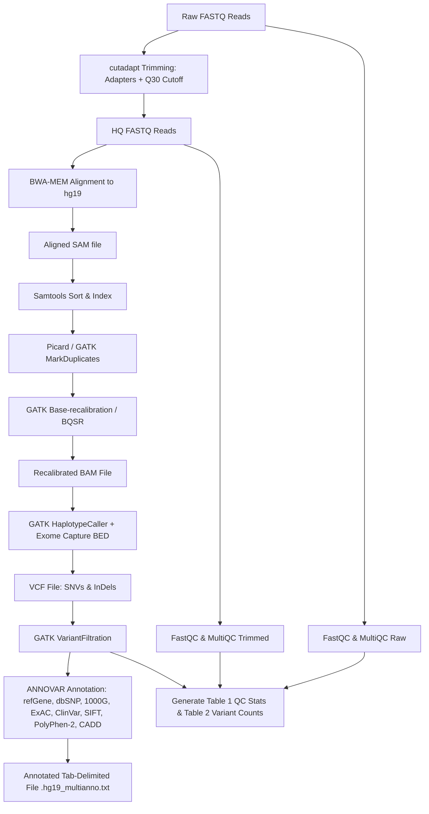

# Biokart Whole Exome Sequencing (WES) Analysis Pipeline

[](https://www.nextflow.io/)
[](https://www.docker.com/)
[](http://genome.ucsc.edu/)
[](LICENSE)

A reproducible, production-ready Next Generation Sequencing (NGS) analysis pipeline built with **Nextflow** and **DSL2** conforming to the **Biokart India Pvt. Ltd. Whole Exome Sequencing (WES)** SNV and InDel analysis specification.

---

## 🔬 Pipeline Architecture



---

## 📋 Analysis Modules & Specifications

| Module | Tool | Specifications / Parameters | Output |
| :--- | :--- | :--- | :--- |
| **1. Raw QC** | `FastQC` + `MultiQC` | Phred quality scores, GC content, duplicate level, adapter contamination | QC report & plots |
| **2. Trimming** | `cutadapt` | 5' and 3' adapter removal, **Phred quality cutoff Q30** (`-q 30,30`), min length 36 bp | HQ FASTQ reads |
| **3. HQ QC** | `FastQC` + `MultiQC` | Post-trim quality assessment | HQ QC metrics |
| **4. Alignment** | `BWA-MEM` | Aligns HQ reads to human reference **`hg19`** (`GRCh37`) with read groups | Aligned SAM / sorted BAM |
| **5. Post-Alignment** | `Picard` / `GATK` | Flag duplicate reads (`MarkDuplicates`) + Base Quality Score Recalibration (`BaseRecalibrator`, `ApplyBQSR`) | Recalibrated BAM (`.bqsr.bam`) |
| **6. Variant Calling** | `GATK HaplotypeCaller` | Calls single nucleotide variations (SNVs) and small InDels with target BED (`-L`) | `sample.filtered.vcf.gz` |
| **7. Annotation** | `ANNOVAR` | `table_annovar.pl` using `refGene`, `avsnp150`, `1000g2015aug_all`, `exac03`, `clinvar_20221231`, `dbnsfp42a` (SIFT, PolyPhen, CADD) | `.hg19_multianno.txt` & `.vcf` |
| **8. Reporting** | Custom Report Generator | Generates **Table 1** (QC Before/After Trimming) & **Table 2** (Total SNVs & InDels) + MultiQC | HTML & TSV summary tables |

---

## 📊 Summary Tables Generated

### Table 1: QC Stats of Paired Reads Before and After Quality Trimming
- **Columns**: Sample Name, Files (`_R1`, `_R2`), Raw Reads (millions), Raw % GC, Raw % Dups, Raw Data (GB), HQ Reads (millions), HQ % GC, HQ % Dups, HQ Data (GB).
- Generated at: `results/reports/Table1_QC_stats.tsv` and `.html`.

### Table 2: Number of Variants Called in the Sample
- **Columns**: Sample Name, Total SNV & small InDels (with individual SNV and InDel counts).
- Generated at: `results/reports/Table2_Variant_stats.tsv` and `.html`.

---

## 🚀 Quick Start & Reproducibility Guide

### 1. Requirements
- Nextflow $\ge$ 23.04.0
- Docker or Singularity (or Conda environment)
- Java 11+

### 2. Download Reference Files
Run the automated preparation script to download and index `hg19` and known sites:
```bash
./scripts/download_references.sh
```

### 3. Run Pipeline with Docker
```bash
nextflow run main.nf \
    -profile standard \
    --input 'data/*_{R1,R2}*.fastq.gz' \
    --genome hg19 \
    --fasta resources/genomes/hg19/hg19.fa \
    --bed resources/exome_targets.bed \
    --outdir results
```

### 4. Run Pipeline with Sample Sheet
```bash
nextflow run main.nf \
    -profile standard \
    --sample_sheet resources/sample_sheet.csv \
    --genome hg19 \
    --fasta resources/genomes/hg19/hg19.fa \
    --bed resources/exome_targets.bed \
    --outdir results
```

---

## ⚙️ Key Configuration Parameters

| Parameter | Default | Description |
| :--- | :--- | :--- |
| `--input` | `'./data/*_{R1,R2}*.{fastq,fq,fastq.gz}'` | Input FASTQ paired-end file glob |
| `--genome` | `'hg19'` | Reference genome version |
| `--fasta` | `''` | Path to reference genome FASTA |
| `--bed` | `''` | Exome capture target regions BED file |
| `--trimmer` | `'cutadapt'` | Trimming tool (`cutadapt`, `fastp`, `trimmomatic`) |
| `--quality_cutoff` | `30` | Phred quality score cutoff for cutadapt |
| `--annotator` | `'annovar'` | Variant annotation tool (`annovar`, `snpeff`, `vep`) |
| `--annovar_dir` | `''` | Directory containing ANNOVAR databases |
| `--outdir` | `'./results'` | Output directory for all published deliverables |

---

## 📁 Output Directory Structure

```
results/
├── qc/
│   ├── fastqc_raw/             # FastQC reports for raw FASTQs
│   ├── fastqc_trimmed/         # FastQC reports for HQ FASTQs
│   └── cutadapt/               # Cutadapt trimming logs
├── trimmed/                    # High-quality (HQ) FASTQs (*.trimmed.fastq.gz)
├── aligned/                    # Aligned, sorted, duplicate-marked & recalibrated BAMs
├── variants/                   # Filtered VCF files (*.filtered.vcf.gz)
├── annotation/                 # ANNOVAR multi-annotation tab-delimited files (*.hg19_multianno.txt)
└── reports/
    ├── Table1_QC_stats.tsv     # Table 1: QC stats before & after trimming
    ├── Table1_QC_stats.html    # Table 1: Formatted HTML table
    ├── Table2_Variant_stats.tsv# Table 2: Total SNVs & InDels per sample
    ├── Table2_Variant_stats.html# Table 2: Formatted HTML table
    └── multiqc/                # MultiQC aggregated report
```